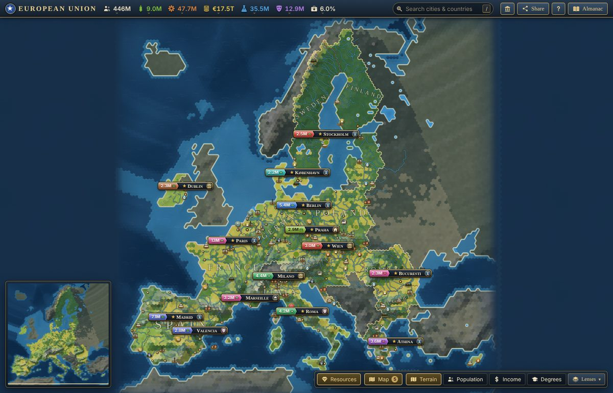

# EU Civ

A Civilization-style hex map of the European Union built from real public data: 238 metro regions as cities,
1,149 NUTS 3 regions, the 27 member states, terrain from elevation and land cover, and yields from Eurostat
(Food = farm jobs, Production = industry + construction jobs, Gold = GDP, Science = ICT + professional jobs,
Culture = arts and services jobs).

**Live:** https://kalfasyan.github.io/eu-civ/



This is an adaptation of Andrej Karpathy's [usaciv](https://github.com/karpathy/usaciv) (MIT, see
`LICENSE-usaciv`). The frontend is his engine with EU wording, euros and the games and military advisor removed;
the data pipeline in `pipeline/` is new.

## Run locally

It is a static site with no build step:

```
python3 -m http.server 8765
# open http://localhost:8765/
```

## Rebuild the data

The scripts write JSON into `data/`. Downloads go into `raw/` and intermediate files into `interim/` (neither is committed).

Requirements: Python 3.10+, `numpy shapely pyproj pillow rasterio openpyxl`.

Inputs to place in `raw/` before running:

- `nuts/` NUTS 2016/2021/2024 region and country files from [eurostat/Nuts2json](https://github.com/eurostat/Nuts2json) (EPSG:3035, 1:10M)
- `ne/` Natural Earth 1:10m rivers, lakes, roads, railroads, populated places (GeoJSON)
- `terrarium/` Terrarium elevation tiles at zoom 7 (AWS Terrain Tiles)
- `worldcover/` ESA WorldCover 2021 overviews (`pipeline/fetch_worldcover.py`)
- `metro/Metro-regions-NUTS-2016.xlsx` from Eurostat's metropolitan regions page
- `misc/` WRI Global Power Plant Database (`gppd.csv`), UNESCO World Heritage list (`whc_sites.csv`), UN/LOCODE (`unlocode.csv`), OurAirports (`airports.csv`)
- `usaciv_world.json`: usaciv's `web/data/world.json`, used only as the template for the terrain rule tables (or set `USACIV_WORLD`)

Eurostat tables are fetched on demand from the JSON-stat API and cached in `raw/eurostat/`.

Then, from `pipeline/`:

```
python3 build_world.py
python3 build_econ.py
python3 build_lenses.py
python3 build_sites.py
python3 build_people.py
python3 build_sources.py
```

Every source, with links and licences, is listed in the in-app Almanac (`data/sources.json`).
